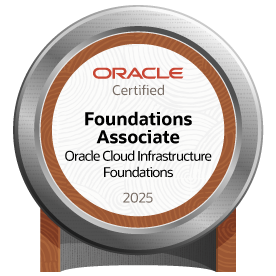

# Olá! Me chamo Bernardo 👋

**`Full Stack`** • **`Cloud`** • **`2x OCI Certified`** • **`Software Engineering`**

Sou desenvolvedor full stack com 4 anos de experiência, 2 vezes certificado pela Oracle em OCI. Desenvolvi desde aplicativos para celular até websites e APIs. Atualmente, estou no 6º semestre do curso de Engenharia de Software na Universidade Federal do Ceará - Campus Russas.

Tenho vivência em Scrum e metodologias ágeis, além de experiência prática em desenvolvimento frontend, backend, cibersegurança e computação em nuvem, áreas nas quais busco aprofundar meu conhecimento técnico e aplicar na construção de soluções robustas.

Nos últimos anos, tenho me dedicado principalmente a tecnologias como: JavaScript, TypeScript, Node.js, React, Express, Python, FastAPI, Django, Java, Spring Boot, PostgreSQL, AWS e OCI.

### Certificações

### Tecnologias que tenho experiência

#### Front-end

#### Back-end

#### Cloud

#### Outros

### Contatos

